<div align="center">

# Chrysalis

**Чистый «стеклянный» рабочий стол на Hyprland для Debian и Ubuntu — один скрипт, и система готова, а цвета подстраиваются под ваши обои.**

[](README.md)
[](README.ru.md)


</div>

<table>
  <tr>
    <td>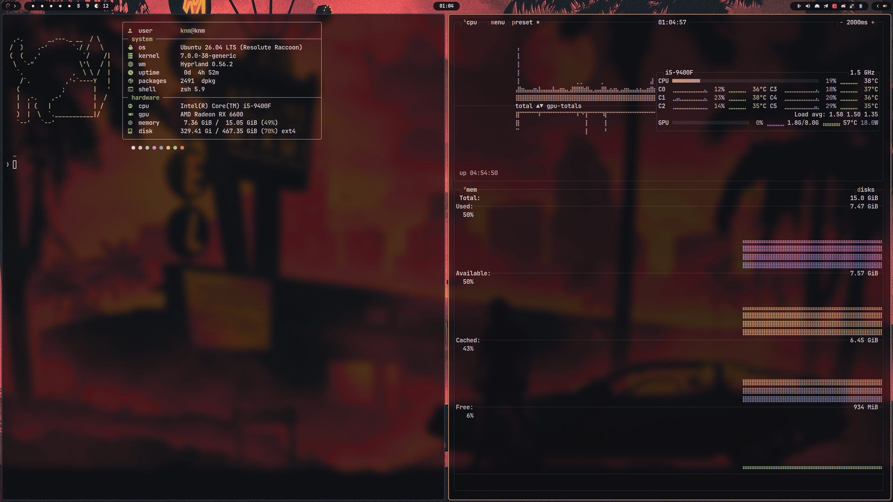</td>
    <td>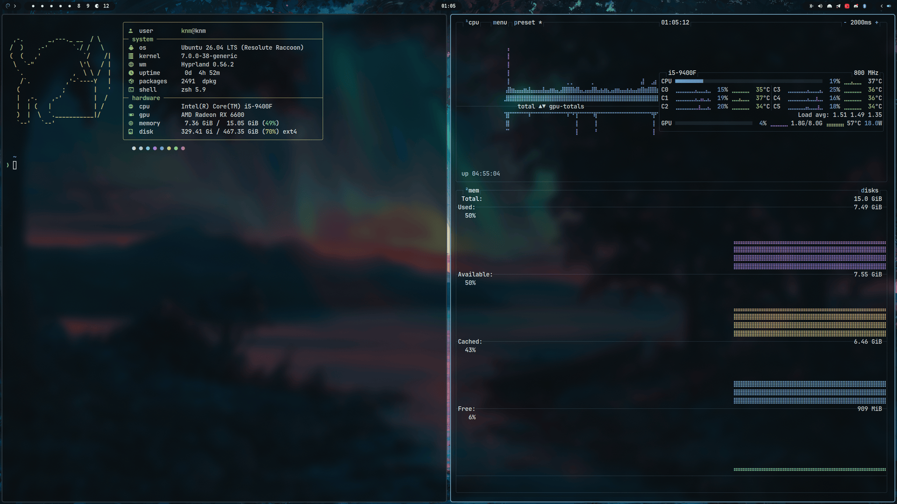</td>
  </tr>
  <tr>
    <td align="center"><sub>Один и тот же стол на двух обоях — все цвета взяты из картинки</sub></td>
    <td align="center"><sub>Терминал, btop, панель, рамки и меню перекрашиваются вместе</sub></td>
  </tr>
</table>

### **[Возможности](#возможности) · [Установка](#установка) · [Темы](#темы) · [Сочетания клавиш](#сочетания-клавиш) · [Структура](#структура)**

---

## Скриншоты

| Обзор рабочих столов — `Super+Tab` | Главное меню — `Super+Alt+Space` |
|:---:|:---:|
| 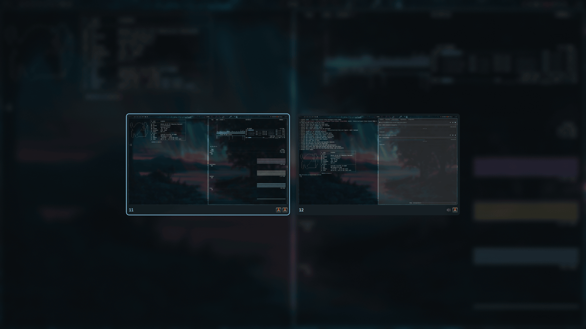 | 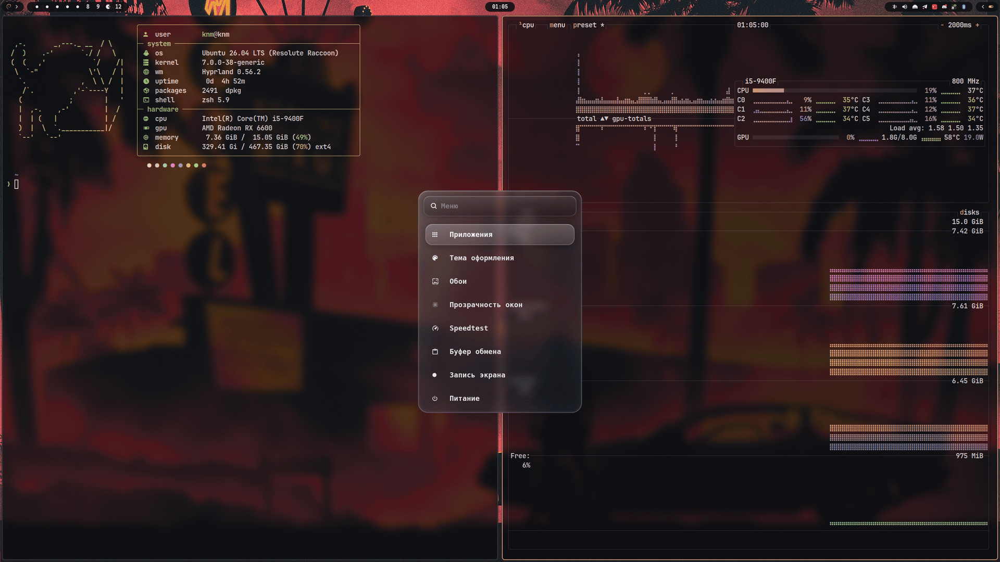 |
| **Выбор темы** — «Из обоев» следует за обоями | **Меню питания** — `Super+Shift+E` |
| 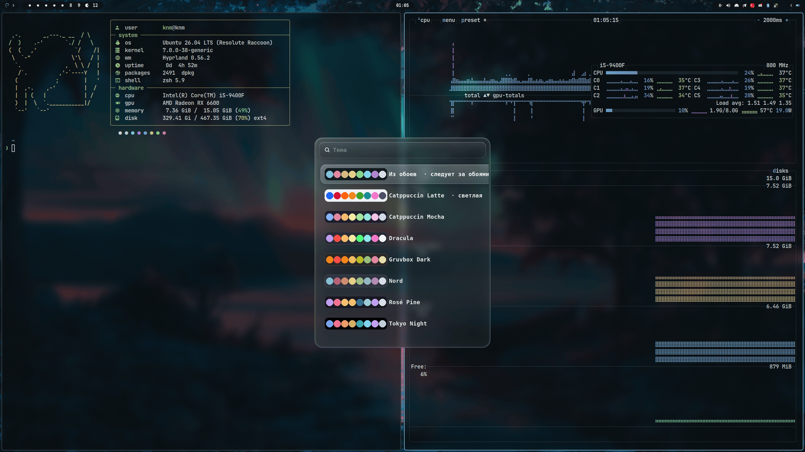 | 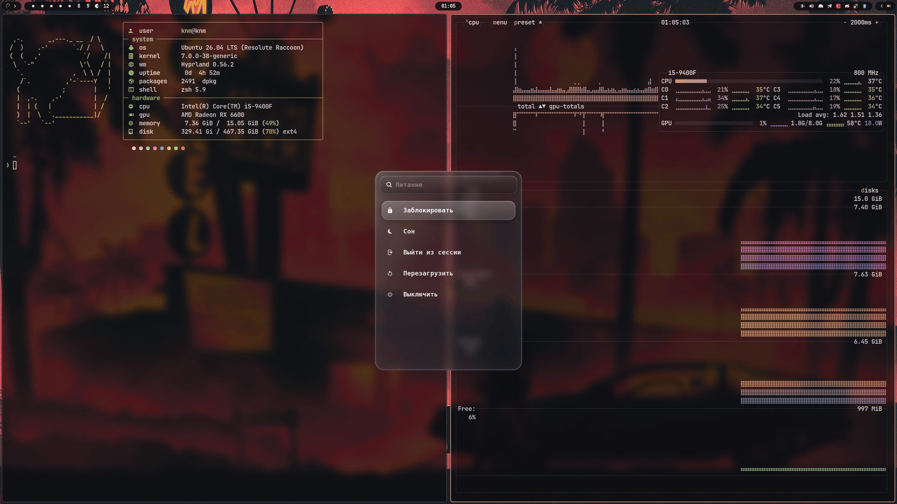 |
| **Прозрачность окон** — `Super+O` | **Индикатор громкости и яркости** |
| 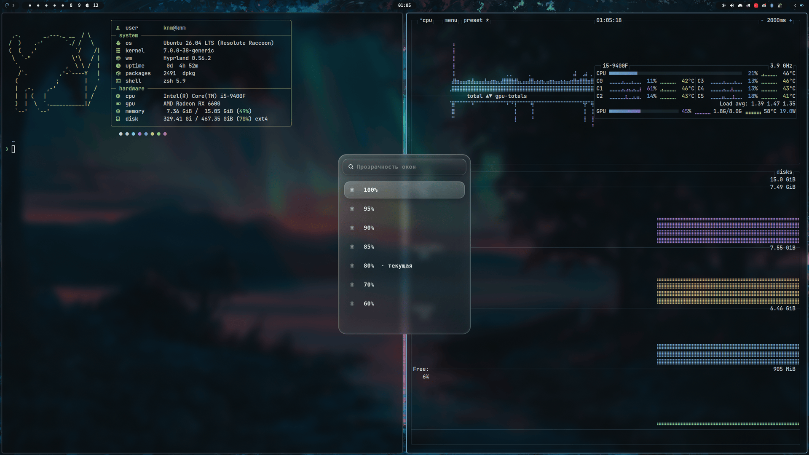 |  |

<details>
<summary>Ещё скриншоты</summary>

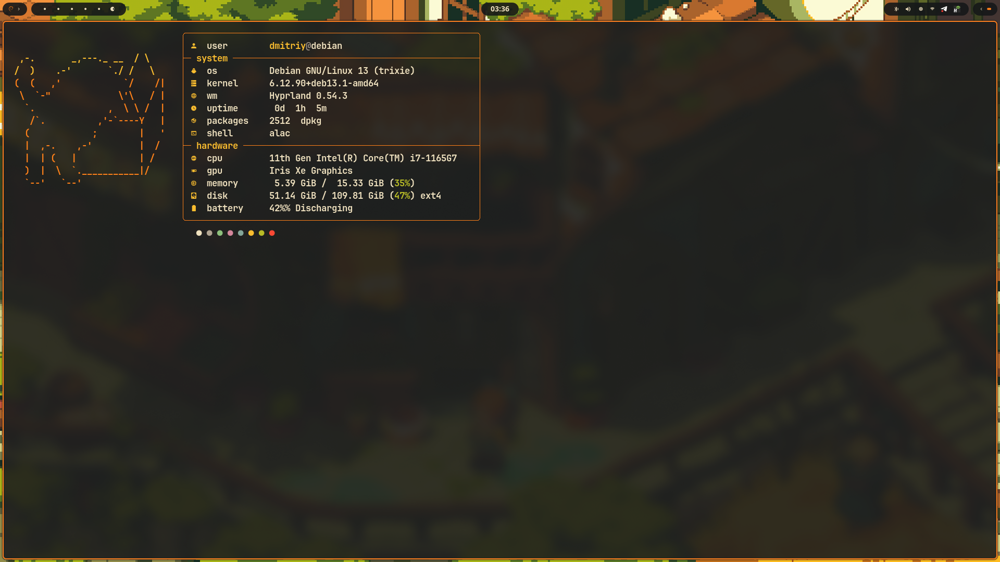
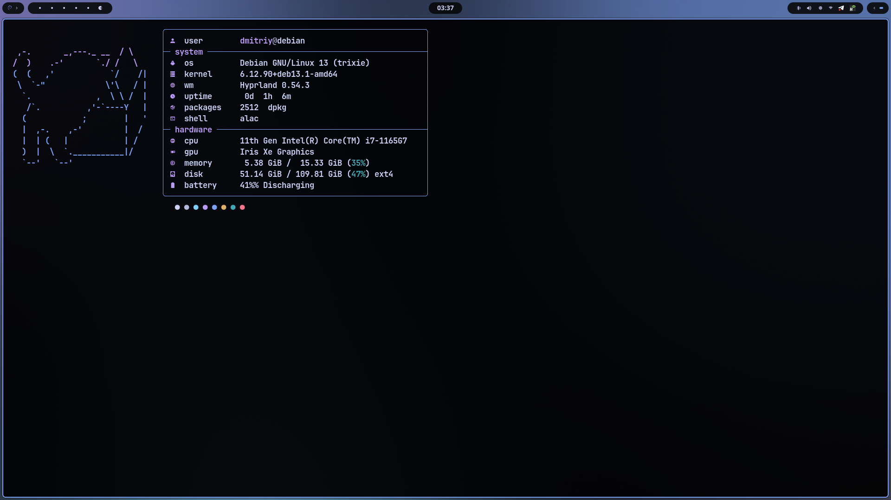
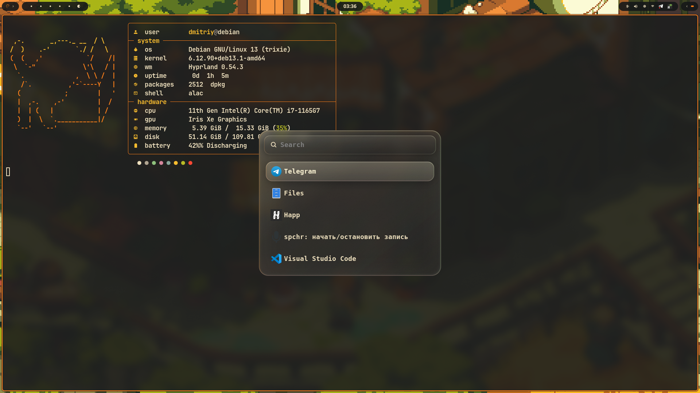
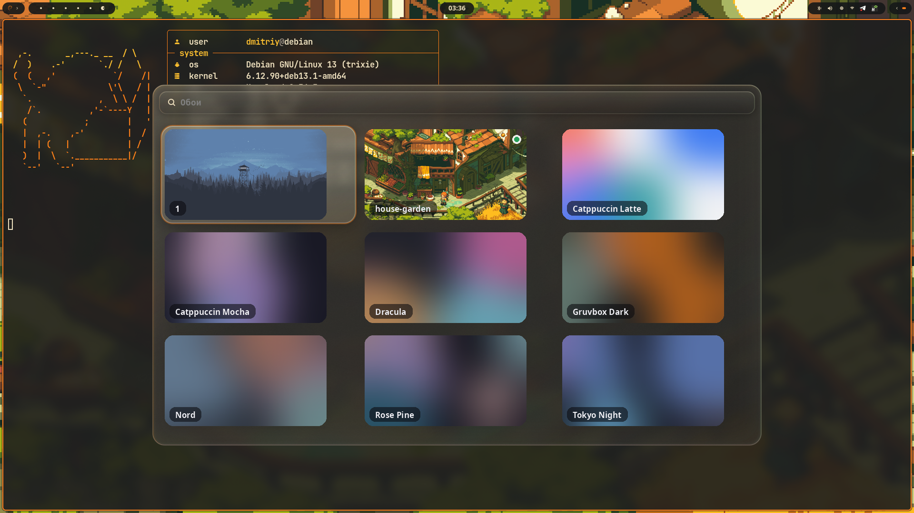

</details>

---

## Возможности

### Внешний вид и темы
- **Hyprland** (≥ 0.54) с размытием, «жидким стеклом» у всплывающих слоёв и упругими анимациями
- **Система тем** — 7 палитр в JSON; `theme-apply <id>` перекрашивает *всё* разом:
  рамки Hyprland · hyprlock · waybar · swaync · wofi · swayosd · alacritty · kitty · Powerlevel10k · GTK 3/4 · Qt/KDE (`kdeglobals`) · VS Code · Firefox (userChrome) · btop · cava · fastfetch · иконки папок (Adwaita в цвет акцента) · тёмный/светлый режим `gsettings` (Firefox и Chromium следуют за ним)
- **Тема из обоев** — `theme-from-wallpaper` строит палитру по текущим обоям (тёмная или светлая выбирается сама); выберите **Из обоев** в меню тем, и вся система будет перекрашиваться при каждой смене обоев
- **Прозрачность окон** — `Super+O` (100…60 %): полупрозрачные окна поверх размытых обоев; полноэкранные окна, видеоплееры, просмотрщики картинок и Resolve остаются непрозрачными
- **Усиление контраста** — `theme-apply --contrast 0..1` уводит фоны к чёрному/белому, не трогая акценты
- **Приглашение в цветах темы** — фиксированные 256-цветные коды Powerlevel10k переводятся в 16 цветов терминала (`~/.p10k.zsh` не меняется)
- **Обои** — для каждой темы генерируется mesh-градиент, выбор с миниатюрами, анимированный круговой переход (как `grow` у swww, но без swww)

### Рабочий стол
- **Обзор рабочих столов** — `Super+Tab` показывает все занятые столы стеклянной сеткой с миниатюрами; выбор мышью или клавишами, перетащите иконку приложения, чтобы перенести окно, средний клик — закрыть его
- **Waybar** — рабочие столы, mpris, скрытые выдвижные группы (батарея / cpu / нагрузка, память / температура), bluetooth, громкость, подсветка, сеть, трей, центр уведомлений swaync, таймер записи экрана
- **Вкладки окон** — группы Hyprland с панелью вкладок в цветах темы; сплит остаётся сплитом, новые вкладки — только по команде (`hypr-new-tab`)
- **Плавающие утилиты** — pavucontrol, настройки сети, blueman, polkit, swappy и диалоги «Открыть/Сохранить» открываются по центру поверх окон; видео «картинка в картинке» закрепляется в углу на всех столах
- **Блокировка и простой** — `hyprlock` поверх размытого снимка экрана в цветах темы (`Super+L`); `hypridle` блокирует через 10 мин, гасит экраны через 11
- **Индикатор громкости и яркости** — плашка `swayosd` в цветах темы на мультимедийных клавишах

### Инструменты
- **Меню wofi** — стеклянное главное меню (`Super+Alt+Space`): приложения · тема · обои · прозрачность окон · speedtest · буфер обмена · запись экрана · питание
- **Меню питания** — заблокировать / сон / выйти / перезагрузить / выключить, опасные действия переспрашивают
- **История буфера обмена** — `cliphist` хранит текст и картинки; `Super+Ctrl+V`
- **Скриншоты** — область / монитор / все экраны сохраняются в `~/Pictures/Screenshots` и копируются; в уведомлении кнопки *Изменить* (аннотации в swappy) и *Папка*
- **Запись экрана** — `wf-recorder` для области или монитора (можно со звуком системы); пульсирующий таймер в waybar, клик по нему — остановить
- **Speedtest** — LibreSpeed в плавающем терминале в цветах темы
- **Автоустановщик** — определяет дистрибутив, подключает backports/PPA для Hyprland, ставит ссылки на конфиги, генерирует обои и применяет тему

---

## Установка

```bash
git clone https://github.com/TklaSnst/Chrysalis
cd Chrysalis
bash install.sh
```

С `--dry-run` можно посмотреть, что будет установлено, ничего не меняя:

```bash
bash install.sh --dry-run
```

**Поддерживается:** Debian 13 (trixie, Hyprland из backports), Ubuntu 24.04+ (Hyprland из PPA; проверено на 26.04), любой дистрибутив на `apt` с Hyprland ≥ 0.54.

Установщик делает **символические ссылки** с `.config/*` и `.local/bin/*` в домашнюю папку, поэтому `git pull` сразу обновляет рабочие конфиги. Уже существующие папки сохраняются как `*.bak`.

---

## Темы

```bash
theme-apply --list          # id  название  режим
theme-apply tokyo-night
theme-apply catppuccin-latte
theme-apply --contrast 0.3  # 0 — палитра как есть, 1 — максимальный контраст (по умолчанию 0.6)
theme-apply --opacity 0.9   # прозрачность окон 0.3..1, перезагружает только Hyprland
```

| id | название | режим |
|----|----------|-------|
| `catppuccin-latte` | Catppuccin Latte | светлая |
| `catppuccin-mocha` | Catppuccin Mocha | тёмная |
| `dracula` | Dracula | тёмная |
| `gruvbox-dark` | Gruvbox Dark | тёмная |
| `nord` | Nord | тёмная |
| `rose-pine` | Rosé Pine | тёмная |
| `tokyo-night` | Tokyo Night | тёмная |
| `wallpaper` | Из обоев | авто |

Или через меню: `Super+Alt+Space` → **Тема оформления**.

### Тема из обоев

```bash
theme-from-wallpaper                    # палитра из текущих обоев и применение
theme-from-wallpaper img.jpg --mode light
theme-from-wallpaper --no-apply         # только записать ~/.config/themes/wallpaper.json
```

Акцент — самый насыщенный цвет, занимающий заметную часть картинки, фоны — её преобладающий оттенок с низкой насыщенностью, а красный, зелёный, жёлтый… остаются узнаваемыми (к акценту они подтягиваются не больше чем на 12°). Пока текущая тема — **Из обоев**, `wallpaper-set` пересчитывает её при каждой смене обоев; выбор любой другой темы это отключает.

### Приложения вне рабочего стола

**VS Code / VSCodium** — `theme-apply` управляет ключами `workbench.colorTheme` (Default Dark/Light Modern) и `workbench.colorCustomizations` в `settings.json`; остальные настройки не трогаются (файл JSONC с комментариями один раз сохраняется в `settings.json.bak`). Применяется сразу.

**Firefox** — пишет `chrome/chrysalis.css` в каждый профиль (обычный, snap, flatpak), подключает его из `userChrome.css`, не затирая ваши правила, и включает `toolkit.legacyUserProfileCustomizations.stylesheets` в `user.js`. Срабатывает после перезапуска Firefox.

**btop / cava** — для каждого своя тема `chrysalis`, выбранная в их конфигах; запущенные программы перечитывают её по `SIGUSR2`.

**Powerlevel10k** — `install.sh` подключает `.config/zsh/p10k-chrysalis.zsh` после `~/.p10k.zsh`; новые терминалы подхватывают цвета сразу (в открытых — `exec zsh`).

### Своя тема

Положите JSON-файл в `.config/themes/` — 23 ключа, все в hex:

```json
{
  "id": "my-theme", "name": "My Theme", "mode": "dark",
  "bg": "#…", "bg_alt": "#…", "surface": "#…", "surface2": "#…",
  "fg": "#…", "fg_dim": "#…", "fg_bright": "#…",
  "accent": "#…", "accent2": "#…",
  "red": "#…", "orange": "#…", "yellow": "#…", "green": "#…",
  "cyan": "#…", "blue": "#…", "magenta": "#…",
  "black": "#…", "bright_black": "#…", "white": "#…", "bright_white": "#…"
}
```

Затем `wallpaper-gen` (создаст `wallpapers/theme-my-theme.png`) и `theme-apply my-theme`.

---

## Обои

```bash
wallpaper-set ~/Pictures/photo.png                  # анимированный переход из случайного угла
wallpaper-set photo.png --pos center                # top-left | top-right | bottom-left | bottom-right | center | random
wallpaper-gen [--force]                             # (пере)создать градиенты для всех тем
```

Выбор обоев (`Super+Alt+Space` → **Обои**) ищет картинки в `~/.config/wallpapers` и `~/Pictures/Wallpapers`.
Позицию перехода по умолчанию можно записать в `~/.config/wallpapers/transition`.

---

## Сочетания клавиш

| Клавиши | Действие |
|---------|----------|
| `Super + Return` | Терминал (alacritty) |
| `Super + Space` | Запуск приложений (wofi drun) |
| `Super + Alt + Space` | Главное меню |
| `Super + Tab` | Обзор рабочих столов (клик / стрелки / `1–0` — перейти, перетащить иконку — перенести окно, средний клик — закрыть) |
| `Super + B` | Браузер (firefox) |
| `Super + C` | VS Code |
| `Super + V` | DaVinci Resolve |
| `Super + P` | Скриншот области → файл + буфер |
| `Print` / `Shift + Print` / `Ctrl + Print` | Скриншот области / всех экранов / монитора → файл + буфер |
| `Alt + Print` / `Super + Ctrl + P` | Область сразу в редактор swappy |
| `Super + Alt + R` | Запись области (повторно — стоп) |
| `Super + Alt + Shift + R` | Запись монитора со звуком системы |
| `Super + Ctrl + V` | История буфера обмена |
| `Super + O` | Меню прозрачности окон |
| `Super + L` | Заблокировать экран |
| `Super + Shift + E` | Меню питания |
| `Super + Shift + Q` | Закрыть окно |
| `Super + Shift + V` | Плавающее окно вкл/выкл |
| `Super + Shift + F11` | Полноэкранный режим |
| `Super + T` / `Super + Shift + P` | Группа (вкладки) вкл/выкл |
| `Super + Shift + T` | Вынуть вкладку из группы |
| `Super + Ctrl + T` | Заморозить / разморозить группу |
| `Super + Grave` (`` ` ``) / `Super + Shift + Grave` | Следующая / предыдущая вкладка |
| `Super + Ctrl + 1–9` | Вкладка по номеру |
| `Super + Ctrl + Shift + ←/→` | Переставить вкладку |
| `Super + Alt + стрелки` | Перенести окно в соседнюю группу / половину сплита |
| `Super + Shift + Return` / `+ B` / `+ Space` | Новая вкладка: терминал / firefox / любое приложение (wofi) |
| `Super + ЛКМ` / `Super + ПКМ` | Перетащить (бросить на панель вкладок — объединить) / изменить размер |
| `Super + J` | Повернуть сплит |
| `Super + Shift + X` | Закрепить окно на всех столах |
| `Super + S` / `Super + Shift + S` | Показать scratchpad / убрать в него |
| `Super + R` | Режим изменения размера (стрелки, `Esc` — выход) |
| `Super + стрелки` / `Super + Shift + стрелки` | Фокус / перемещение окна |
| `Super + 1–0` / `Super + Shift + 1–0` | Перейти на стол / перенести окно на стол |
| `Super + колесо` | Следующий / предыдущий стол |
| `Super + Shift + C` | Перезагрузить Hyprland |
| `Caps Lock` | Переключить раскладку (us / ru) |
| Свайп 3 пальцами ←→ / ↓ (+Alt) / ↑ (+Super) | Стол / закрыть / полный экран |

---

## Структура

```
.
├── install.sh
├── screenshots/
├── .config/
│   ├── hypr/hyprland.conf        # подключает theme.conf (генерируется)
│   ├── hypr/hyprlock.conf        # экран блокировки, цвета из theme.conf
│   ├── hypr/hypridle.conf        # простой: приглушить → заблокировать → погасить
│   ├── waybar/                   # config.jsonc → layouts/with_music.jsonc + modules.jsonc
│   ├── wofi/                     # style.css (стекло), style-wallpaper.css, конфиги меню
│   ├── swaync/                   # центр уведомлений
│   ├── alacritty/                # alacritty.toml + binds.toml (theme.toml генерируется)
│   ├── kitty/kitty.conf          # подключает theme.conf (генерируется)
│   ├── fastfetch/logo.txt        # config.jsonc генерируется
│   ├── swappy/config             # редактор скриншотов: папка, шрифт
│   ├── zsh/p10k-chrysalis.zsh    # цвета Powerlevel10k → палитра терминала
│   ├── rofi/                     # запуск приложений rofi для кнопки «Пуск» в waybar
│   ├── themes/*.json             # палитры
│   └── wallpapers/               # обои из комплекта; сюда же генерируются theme-*.png
└── .local/bin/
    ├── theme-apply               # движок тем (python, только stdlib + GTK)
    ├── theme-from-wallpaper      # палитра из обоев → тема «wallpaper»
    ├── wofi-main-menu            # Super+Alt+Space
    ├── wofi-theme                # выбор темы со свотчами палитр
    ├── wofi-wallpaper            # сетка обоев с миниатюрами
    ├── wofi-power                # меню питания (Super+Shift+E)
    ├── wofi-opacity              # прозрачность окон (Super+O)
    ├── wofi-clipboard            # история буфера обмена (Super+Ctrl+V)
    ├── hypr-overview             # обзор столов Super+Tab (GTK layer-shell)
    ├── hypr-overview-snap        # кэширует миниатюры столов для обзора
    ├── hypr-new-tab              # открыть приложение вкладкой в текущей группе
    ├── screenshot                # область / монитор / экраны / редактор + уведомление
    ├── screen-record             # запись wf-recorder + статус для waybar
    ├── notify-action             # уведомление с кнопками (замена notify-send -A)
    ├── wallpaper-gen             # mesh-градиент для каждой темы (Pillow)
    ├── wallpaper-set             # поставить обои с переходом
    ├── wallpaper-transition      # круговое проявление на GTK layer-shell
    ├── speedtest-menu / -run     # LibreSpeed в плавающем alacritty
    └── waybar-autostart          # перезапуск waybar при старте сессии
```

---

## Как устроена система тем

```
themes/<id>.json ──► theme-apply ──► hypr/theme.conf, waybar/colors/colors.css,
                        │            swaync/colors/colors.css, wofi/colors.css,
                        │            swayosd/style.css,
                        │            alacritty/theme.toml, kitty/theme.conf,
                        │            gtk-3.0/gtk.css, gtk-4.0/gtk.css, kdeglobals,
                        │            fastfetch/config.jsonc, icons/ThemeAccent,
                        │            Code/User/settings.json, firefox/<profile>/chrome,
                        │            btop/themes/chrysalis.theme, cava/themes/chrysalis
                        └──► gsettings color-scheme / gtk-theme / icon-theme
                             hyprctl reload · перезапуск waybar · swaync reload · перезапуск swayosd · kitty SIGUSR1 · btop/cava SIGUSR2

обои ──► theme-from-wallpaper ──► themes/wallpaper.json ──► theme-apply wallpaper
```

Каждая цель — небольшая функция в `theme-apply`; чтобы поддержать новое приложение, добавьте функцию, которая пишет его файл, и допишите её в кортеж в `main()`. Сгенерированные файлы помечены заголовком и игнорируются git.

---

## Зависимости

`install.sh` ставит их сам:

| Пакет | Зачем |
|-------|-------|
| `hyprland` ≥ 0.54, `xdg-desktop-portal-hyprland/-gtk` | Композитор и порталы |
| `waybar` | Панель |
| `wofi` | Запуск приложений и меню |
| `rofi` | Запуск приложений для кнопки «Пуск» в waybar |
| `sway-notification-center` | Уведомления / центр управления |
| `swaybg` | Обои |
| `alacritty` (`kitty` по желанию) | Терминал |
| `fastfetch`, `librespeed-cli` | Вывод в терминале / меню |
| `grim` + `slurp` + `swappy` + `wl-clipboard` | Скриншоты и аннотации |
| `jq`, `socat` | `hypr-new-tab`, миниатюры обзора |
| `hyprlock`, `hypridle` | Экран блокировки, простой |
| `cliphist` | История буфера обмена |
| `swayosd` | Индикатор громкости / яркости |
| `wf-recorder` | Запись экрана |
| `playerctl`, `brightnessctl`, `pulseaudio-utils` | Мультимедийные клавиши |
| `pipewire` + `wireplumber` | Звук |
| `network-manager-gnome`, `blueman` | Апплеты |
| `python3-pil`, `python3-gi`, `gir1.2-gtklayershell-0.1`, `gir1.2-notify-0.7` | Движок тем, обзор, миниатюры, переход обоев, уведомления |
| `btop`, `cava` (дополнительно) | Монитор системы и визуализатор звука в цветах темы |
| Nerd Fonts (CaskaydiaCove, JetBrainsMono) | Иконки в waybar / wofi / swaync (скачиваются по запросу) |
